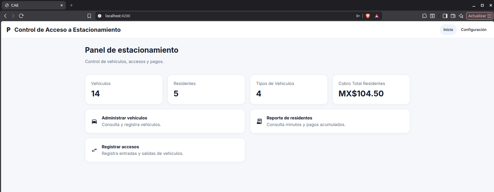
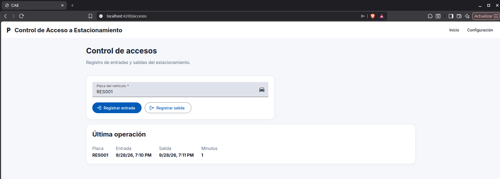
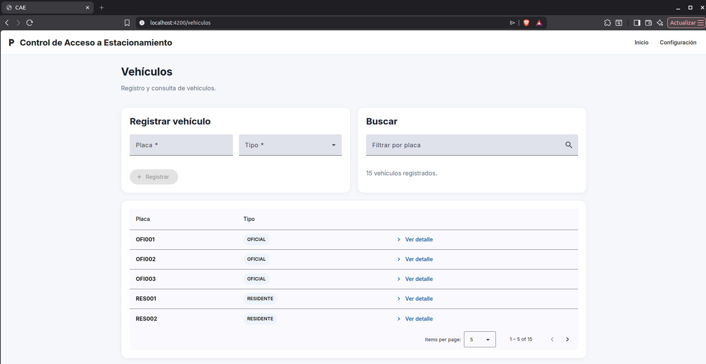
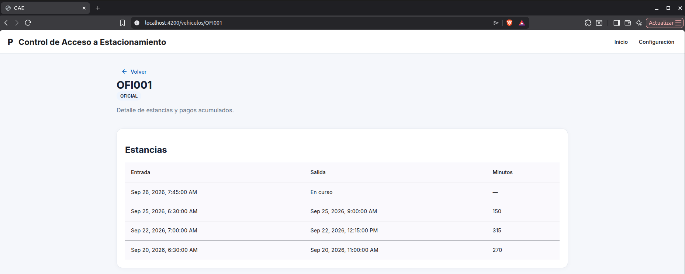
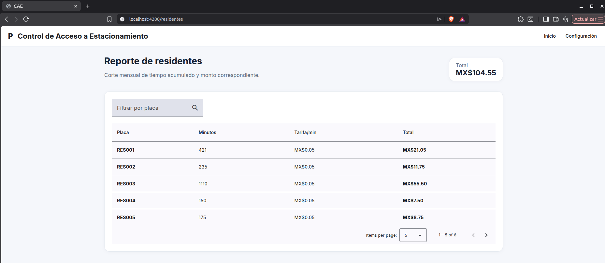
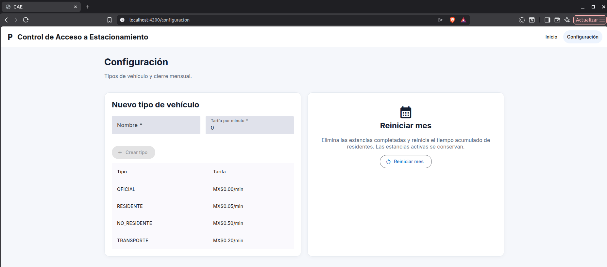

# Full-Stack-Prueba-tecnica-Neology

Aplicación Full-Stack para la gestión de accesos y estancias de vehículos en un estacionamiento.

El proyecto está compuesto por:

- **Backend:** Spring Boot + Java 17
- **Frontend:** Angular 18 + Angular Material + TypeScript
- **Base de datos:** H2 en memoria

---

## Requisitos previos

Para ejecutar el proyecto es necesario contar con:

- Java 17 o superior
- Node.js
- npm

El backend incluye Maven Wrapper, por lo que no es necesario tener Maven instalado globalmente.

---

## Levantar el backend

Desde la raíz del proyecto:

```bash
cd backend
```

### Linux / macOS

```bash
./mvnw spring-boot:run
```

### Windows

```bash
mvnw.cmd spring-boot:run
```

Una vez iniciado, el backend estará disponible en:

```text
http://localhost:8080
```

La API también puede consultarse y probarse mediante Swagger UI:

```text
http://localhost:8080/swagger-ui.html
```

---

## Levantar el frontend

En otra terminal, desde la raíz del proyecto:

```bash
cd frontend
```

Instalar las dependencias:

```bash
npm install
```

Iniciar la aplicación:

```bash
npm start
```

El frontend estará disponible en:

```text
http://localhost:4200
```

El frontend utiliza `proxy.conf.json` para redirigir las solicitudes realizadas a `/neo` hacia el backend ejecutándose en `http://localhost:8080`.

---

## Realizar pruebas

Las pruebas automatizadas se encuentran en el backend y cubren la lógica principal del sistema.

Desde la carpeta `backend`:

### Linux / macOS

```bash
./mvnw test
```

### Windows

```bash
mvnw.cmd test
```

Las pruebas cubren funcionalidades como:

- Registro de entradas y salidas.
- Cálculo de minutos de estancia.
- Cálculo de importes según el tipo de vehículo.
- Acumulación de minutos de residentes.
- Validación de estancias activas.
- Inicio de un nuevo mes.

---

## Base de datos precargada

El proyecto utiliza una base de datos **H2 en memoria**, por lo que no es necesario instalar ni configurar un servidor de base de datos externo.

Al iniciar el backend, Hibernate crea automáticamente la estructura de la base de datos y posteriormente se ejecuta:

```text
backend/src/main/resources/data.sql
```

Los datos precargados incluyen:

- Tipos de vehículo.
- Vehículos oficiales.
- Vehículos residentes.
- Vehículos no residentes.
- Vehículos de tipos personalizados.
- Residentes con minutos acumulados.
- Estancias completadas.
- Estancias activas.

### Consola H2

La consola de H2 puede consultarse en:

```text
http://localhost:8080/h2-console
```

Datos de conexión:

```text
JDBC URL: jdbc:h2:mem:neologydb
User: sa
Password: sa
```

La contraseña se encuentra vacía.

---

## Capturas de pantalla

A continuación se muestran las principales funcionalidades del frontend.

### Dashboard (Interfaz de inicio)



### Control de accesos

Interfaz dedicada al registro de entradas y salidas del estacionamiento.



### Gestión de vehículos

Interfaz dedicada al registro vehiculos y busquedas de vehiculos mediante la placa.

Implementa paginación y ordenamiento para una mejor visibilidad de los datos.



### Detalle de vehículo

Interfaz para visualizar el detalle e historial de las estancias, tambien muestra montos acumulados de pagos para los vehiculos correspondientes.

Se llega a esta interfaz desde la interfaz de Gestión de vehículos.



### Reporte de residentes

Esta interfaz permite visualizar un informe de residentes donde se muestra el detalle de cada residente registrado, ademas de calcular el monto de pago acumulado total.

Contiene tambien un filtro para ralizar busquedas por la placa del vehiculo.

Implementa paginación y ordenamiento para una mejor visibilidad de los datos.



### Configuración

Esta interfaz permite realizar funciones:

- Agregar nuevos tipos de vehiculos.
- Realizar reinicio de estancias y montos acumulados.



---

## Organización y buenas prácticas

El proyecto se encuentra separado en frontend y backend, manteniendo las responsabilidades de cada parte de la aplicación independientes.

```text
Neology/
├── backend/
├── frontend/
├── docs/
│   └── images/
└── README.md
```

### Backend

El backend utiliza una arquitectura por capas para separar las responsabilidades de la aplicación.

```text
backend/src/main/java/
├── config/
├── constants/
├── controller/
├── dao/
├── dto/
├── entity/
├── exception/
├── service/
└── util/
```

El flujo principal de una solicitud es:

```text
Controller
    ↓
Service
    ↓
DAO / Repository
    ↓
H2
```

Se aplican prácticas como:

- Separación entre controladores, lógica de negocio y persistencia.
- Uso de DTOs para la comunicación de la API.
- Uso de interfaces e implementaciones en la capa de servicios.
- Manejo global de excepciones.
- Validación de los datos recibidos por la API.
- Normalización centralizada de datos.
- Uso de constantes para valores de negocio.
- Manejo transaccional mediante Spring.
- Inyección de dependencias.
- Pruebas unitarias para la lógica principal del negocio.

### Frontend

El frontend está organizado por funcionalidades y utiliza componentes standalone de Angular.

```text
frontend/src/app/
├── core/
│   ├── models/
│   └── services/
├── features/
│   ├── access/
│   ├── dashboard/
│   ├── residents/
│   ├── settings/
│   └── vehicles/
└── shared/
```

Se aplican prácticas como:

- Organización de componentes por funcionalidad.
- Separación entre lógica TypeScript, templates HTML y estilos SCSS.
- Servicio centralizado para la comunicación con el backend.
- Modelos TypeScript para representar solicitudes y respuestas.
- Reactive Forms para formularios y validaciones.
- Angular Material para los componentes de interfaz.
- Manejo centralizado de mensajes y errores.
- Paginación y ordenamiento mediante Angular Material.
- Validación de los campos de entrada.
- Protección frente a XSS mediante los mecanismos de renderizado y sanitización proporcionados por Angular.

---

### Mejoras futuras

---

Posteriormente se podrian considerar las siguientes mejoras:

- Mostrar el monto a pagar cuando se registre la salida de un vehículo cuyo tipo no considere pagos montos acumulados.
- Un residente puede tener mas de un vehiculo.
